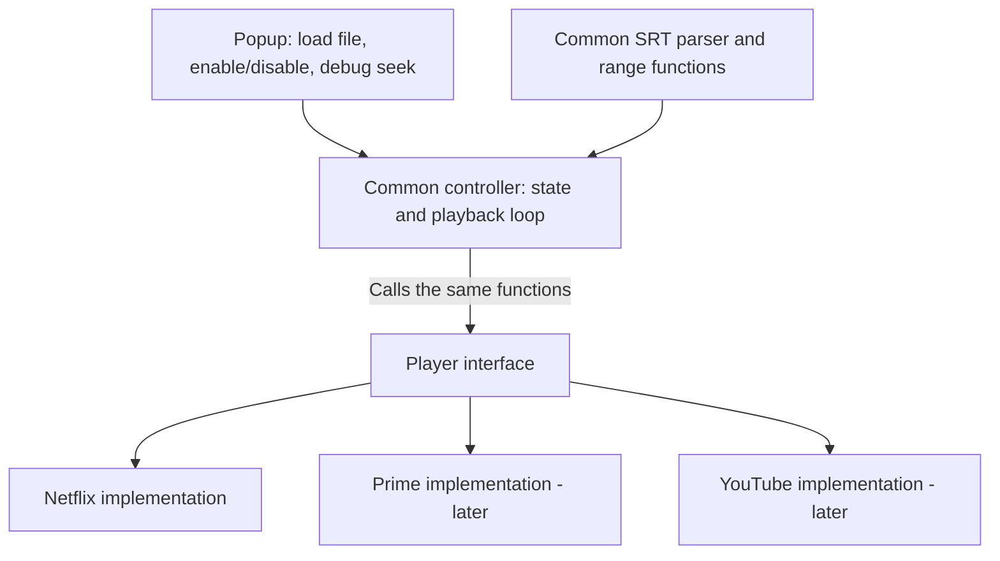
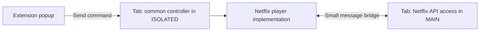

# Scene Skip - simple technical design

Implemented structure for Phases 0 and 1. The user verified the earlier Netflix baseline; this refactor requires another live check from `main`.

## 1. One common mechanism, different players

The controller owns the loop, loaded skip ranges, enabled setting, and errors. It receives one player implementation for the current tab. Only that implementation knows how its platform works.



The controller does not contain Netflix/Prime/YouTube branches. Adding a platform means implementing the interface and selecting that implementation when the tab starts.

## 2. The player interface

```ts
interface Player {
  readPlayback(): Promise<PlaybackSnapshot>;
  seekTo(seconds: number): Promise<SeekObservation>;
}
```

- `PlaybackSnapshot`: current position, duration, and paused/ended state. A separate platform URL function supplies the title ID, even when the player is unavailable.
- `SeekObservation`: requested position and the position actually observed after seeking.
- Shared values use seconds. Each player handles its own API, selectors, unit conversion, and seek-completion check.

Keep this interface limited to implemented operations. Add intro/recap/next actions when those features are built.

## 3. The common loop

Illustrative pseudocode:

```text
while a file is loaded:
    check whether the title changed; clear the file and stop if it did
    playback = await player.readPlayback()
    if enabled, playing, and inside a skip interval:
        await player.seekTo(interval.endSeconds)
    wait 250 ms
```

One iteration finishes before the next starts. Recheck the enabled setting before seeking. Disabling prevents new automatic seeks; an already requested seek may finish. Failures stop the loop and remain visible in the popup. The delay can be tuned after measurement; it does not guarantee frame accuracy.

Parsing, validation, and overlap merging happen once when loading a file. Original-video timestamps remain unchanged after earlier skips. The title check must also work while skipping is disabled or the player is unavailable.

## 4. Where it runs in Chrome



- The popup handles user input and displays results. Opening it installs the packaged tab scripts once, using `activeTab` and `scripting`, then sends commands with `tabs.sendMessage`.
- The controller and file state live in an isolated content script inside the video tab. Closing the popup leaves them running. Reloading or closing the tab destroys them.
- Netflix needs a small MAIN-world adapter to access `window.netflix`. This bridge is part of its player implementation, hidden from the controller. File text and reasons stay in ISOLATED. Page replies are validated but cannot be authenticated against Netflix's own scripts.
- A background service worker has no required job in this flow. Add one when a concrete browser-wide background feature needs it. It does not own the playback loop.

These are design choices within Chrome's supported model: [content scripts](https://developer.chrome.com/docs/extensions/develop/concepts/content-scripts), [popup injection](https://developer.chrome.com/docs/extensions/get-started/tutorial/debug#debug_the_popup), and [worker lifetime](https://developer.chrome.com/docs/extensions/develop/concepts/service-workers/lifecycle).

## 5. Debug seek and implementation order

Manual/debug seek means typing a time such as `01:30` and asking the player to jump there. It calls the same `player.seekTo(90)` used by automatic skipping. It has no separate playback loop.

Phase 0 preserves the working Netflix baseline. Phase 1 organizes that behavior around the common controller and interface. Later phases add the features in [requirements](REQUIREMENTS.md).

The refactor reuses the Netflix reads/seeks, parser, and range logic. Netflix still serializes overlapping seeks, so debug seeking remains usable while automatic skipping is enabled. A failed seek remains a failure; queued dependent seeks do not retry it.

The popup pins commands to the document initialized when it opened. If the video page reloads while the popup is open, reopen the popup. Title changes within the same document clear the file and allow loading a matching file. Other terminal playback failures require a page reload; failures remain visible beside the file.

## 6. Build and test from main

Requires Node.js 24+ and pnpm 11.

```sh
pnpm install --frozen-lockfile
pnpm check
pnpm test
pnpm build
```

1. In Chrome, open `chrome://extensions`, enable Developer mode, and load the project's `dist` directory. After rebuilding an installed copy, reload the extension and video tab.
2. Open an ad-free Netflix title, open the popup, and check current position and forward/backward debug seeking. Paused seeking should stay paused.
3. Load a matching SRT, close the popup, and check skips, pause/resume, and rewind. Reopen it to disable/enable skipping and test the existing clock/segment overlays.
4. Change title with skipping disabled. The previous file must disappear, including while the new player is loading; load a file for the new title. Check an independent second tab and visible invalid-file/player errors.

Automated fixtures cover these decisions and the message path with simulated players. They do not establish live Netflix compatibility or guarantee short-range timing; the sampling delay is still 250 ms.
